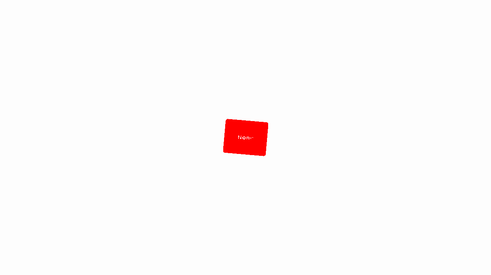

# Integration Testing

When building a component library, ensuring components remain accessible, semantically valid, and visually consistent over time is critical.

Django Design System provides an optional, plugin-based testing engine that automatically loops through **every variant** and **every theme** of your components (or a filtered subset) to run assessments:

- **Accessibility**: runs Axe-core against every component state to catch WCAG violations early.
- **HTML Validation**: strictly parses rendered HTML to catch orphaned or mismatched tags.
- **Visual Regression**: compares rendered components pixel-by-pixel against baselines with Pixelmatch.

---

## 1. Optional Dependencies

Installing `dj-design-system` installs only core requirements. Opt into testing extras as needed:

- **`testing-a11y`**: Playwright + `axe-playwright-python`
- **`testing-visual`**: Playwright + `Pillow` + `pixelmatch`
- **`testing-playwright`**: Playwright only (for HTML validation)
- **`testing-all`**: all testing extras

Because plugins use lazy imports, missing extras raise a clear, actionable `ImportError` telling you which extra to install.

---

## 2. Walkthrough: Testing Components with Pytest

### Step 1: Install Extras

```bash
pip install "dj-design-system[testing-a11y]"
playwright install --with-deps
```

### Step 2: Write the Test

```python
# my_app/tests/test_components.py
from dj_design_system import component_registry
from dj_design_system.testing.engine import IterationEngine
from dj_design_system.testing.plugins import AccessibilityPlugin


def test_component_accessibility(page, live_server):
    a11y_plugin = AccessibilityPlugin(page=page, base_url=live_server.url)
    engine = IterationEngine(components=component_registry.list_all())
    engine.run_plugins([a11y_plugin])
```

### Step 3: Filter Components or Variants

Filters receive `(component, variant, theme)` and return a boolean:

```python
engine = IterationEngine(components=component_registry.list_all())
engine.add_filter(lambda comp, variant, theme: comp.app_label == "core")
engine.add_filter(lambda comp, variant, theme: variant != "maximal")
engine.run_plugins([a11y_plugin])
```

`IterationEngine` automatically visits every enabled documentation variant (`GallerySettings.doc_variants` and component-level `GalleryConfig.doc_variants`) as well as every explicit `Variant` in `GalleryConfig.variants` shown in documentation or navigation.

---

## 3. Available Assessment Plugins

### `AccessibilityPlugin`

Uses [Axe-core](https://github.com/dequelabs/axe-core) to verify WCAG accessibility compliance:

```python
from dj_design_system.testing.plugins import AccessibilityPlugin

plugin = AccessibilityPlugin(
    page=page,
    base_url=base_url,
    disabled_rules=["landmark-one-main", "page-has-heading-one", "region"],
)
```

### `HTMLValidationPlugin`

Strictly parses rendered HTML to catch unclosed, mismatched, or orphaned tags:

```python
from dj_design_system.testing.plugins import HTMLValidationPlugin

plugin = HTMLValidationPlugin(page=page, base_url=base_url)
```

### `VisualRegressionPlugin`

Uses [Pixelmatch](https://github.com/mapbox/pixelmatch) to compare rendered components against known baseline snapshots:

```python
from dj_design_system.testing.plugins import VisualRegressionPlugin

plugin = VisualRegressionPlugin(
    page=page,
    base_url=base_url,
    update_snapshots=False,
    enable_diff=True,
    threshold=0.1,
    baseline_dir="tests/snapshots/baseline",
    actual_dir="tests/snapshots/actual",
    diff_dir="tests/snapshots/diff",
)
```



---

## 4. Writing Custom Plugins

Subclass `AssessmentPlugin` to assert custom invariants (SEO metadata, data attributes, design system conventions):

```python
import urllib.parse
from dj_design_system.testing.engine import AssessmentPlugin


class MyCustomPlugin(AssessmentPlugin):
    def __init__(self, page, base_url):
        self.page = page
        self.base_url = base_url

    def run_assessment(self, component, variant, theme):
        params = {"component": component.qualified_name, "theme": theme}
        url = f"{self.base_url}/_canvas/?{urllib.parse.urlencode(params)}"
        self.page.goto(url)

        if not self.page.locator(".my-required-class").is_visible():
            raise AssertionError(f"{component.name} is missing .my-required-class!")
```

---

<a id="testing-with-override_settings"></a>
## 5. Testing Configuration with `@override_settings`

Use `.replace(...)` on `DesignSystemSettings` inside Django's `@override_settings` to override individual fields cleanly:

```python
from django.test import override_settings
from dj_design_system.config import DesignSystemSettings, GallerySettings


@override_settings(
    DJ_DESIGN_SYSTEM=DesignSystemSettings(
        gallery=GallerySettings(enabled=False),
    )
)
def test_gallery_disabled_returns_404(client):
    assert client.get("/design-system/").status_code == 404
```

`dj_design_system` connects Django's `setting_changed` signal at startup and automatically invalidates both configuration and navigation caches whenever `DJ_DESIGN_SYSTEM` or `INSTALLED_APPS` changes.

### Startup-Bound vs Request-Time Settings

- **Request-time dynamic** settings (`name`, `css`, `js`, `css_bundles`, `js_bundles`, `themes`, `default_theme`, `gallery.*`, `canvas.*`, `AppSettings.{label, order, nav_order, themes, css, extra_css, js, extra_js, css_bundles, js_bundles, canvas_html_attrs}`, `DirectorySettings.{label, order, nav_order, promote_to_app}`) take effect immediately under `@override_settings`.
- **Startup-bound** settings (`AppSettings.{prefix, flatten, short_names}` and `DirectorySettings.{prefix, flatten}`) are baked onto frozen `ComponentInfo` instances during `ComponentRegistry.autodiscover()`. In tests that override these, construct a fresh `ComponentRegistry()` and run discovery inside the `@override_settings` block.
